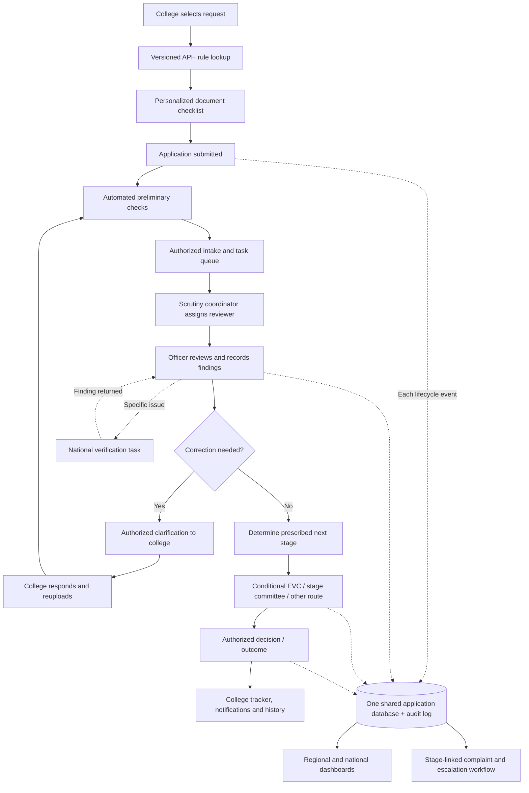

# AICTE Application Workflow Automation — Complete Website Build Prompts

**Purpose:** A comprehensive, sequential prompt pack for an AI coding agent to build a **fully functional interconnected prototype**, starting from scratch, based on the discussed SIH AICTE approval-workflow solution.

**Important boundary:** This is a functional *prototype specification*. It does not claim an official AICTE system, live integration, approved APH mapping, statutory deadlines, real official credentials, or power to issue real approvals. All sample rules, officers, regions, and permissions must be identified as mock until validated. Regulatory decisions remain with authorized humans.

## How to use this file

1. Give your coding agent **Prompt 0** first as its persistent master instructions.
2. Run prompts **1 through 15 in order**, letting the agent implement and test each stage before the next.
3. At each stage insist on actual working code, not screenshots or empty pages.
4. After every stage run the app and test its acceptance criteria. Do not proceed with failures.
5. Keep all work on the user's designated local workspace/branch. **Do not push/deploy to GitHub without explicit authorization**.
6. If an official APH clause or mapping is not confirmed, mark it `NEEDS_APH_VERIFICATION` and do not guess.

---

## Prompt 0 — Permanent master system / product requirements

```text
You are the lead full-stack engineer, product designer, security reviewer, and QA lead building an AICTE Application Workflow Automation prototype for a Smart India Hackathon submission.

Core principle: THIS IS ONE INTERCONNECTED SYSTEM, NOT MULTIPLE DISCONNECTED DASHBOARDS. Every portal reads the same canonical application records. Any authorized action in one portal changes the data and task queues observed in the other portals. Never fake a workflow by changing only UI text or hardcoded counts.

Product personas:
(A) College / institution user.
(B) AICTE National Admin / National Head (oversight; not universal approval authority).
(C) Regional Officer.
(D) Scrutiny Coordinator.
(E) Scrutiny Officer.
(F) Stage Coordinator (EVC/SHC/SAC/other permitted stage).
(G) Stage Member (EVC/SHC/SAC/other permitted stage).
(H) National Verification Officer for case-specific national referrals (proposed platform capability, not a mandatory APH stage).

College experience: select application category, answer conditional intake questions, receive an exact per-application checklist sourced to a versioned APH configuration, upload each required document in its specified slot, submit, see transparent stage-wise progress, respond to clarifications, receive alerts, raise stage-linked delay grievances, see full history and decisions.

AICTE experience: role- and region-scoped work queues, assignment, preliminary automated checks, full application review, findings, clarification loop, stage management, conditional EVC and committee workflows, national verification referral, complaint handling, metrics, notifications and audit trail.

Data and permissions: users can have multiple authorized roles, regions and stage memberships. Role/region selection is restricted to verified assignments, not freely self-declared on a production account. The institution's originating jurisdiction is independent of the current assigned task and can never be overwritten by national referral. National overview is separate from power to change individual outcomes.

Regulatory accuracy: Four tracks (T1 Heavy Inspection, T2 Standard Evaluation, T3 Routine/Eligible Fast Processing, T4 Legal/Restructuring) are PROJECT UI CLASSIFICATIONS, NOT OFFICIAL AICTE CATEGORIES. Workflow steps and documents are controlled by verified APH clauses, application type, effective dates, eligibility conditions, and corrigenda. Never automatically put SAC appeal or EC approval in all routes. Do not automatically grant EoA, issue genuine approvals, or assume EVC is universally required. NBA accreditation does not universally create fast-track eligibility. No arbitrary use of 'nearest region' instead of authoritative jurisdiction mapping.

Deliver a working app with real transitions and persistence. No dead buttons, empty list screens disguised as features, static analytics, or untested actions. Protect access on the server, not only in the frontend. Maintain traceability: rule/version, document, officer, finding, stage transition, timestamp and notification for each action.

For the SIH demo, all accounts, records, maps, APH rules, limits, deadlines and official data are synthetic and prominently labelled DEMO / SIMULATED unless verified. Do not expose secrets in the frontend. Real SMS, payment, NBA, national databases and government integrations must use adapter interfaces with safe demo/mock providers.

Work incrementally. In every stage: inspect existing code, propose minimal change, implement it, run checks, exercise acceptance tests, list changed files and blockers. Do not silently delete past modules.
```

## Prompt 1 — Initialize functional full-stack architecture

```text
Create the entire project from scratch (or inspect and extend the existing repository if files exist). Use React + Vite + TypeScript + React Router + Tailwind CSS + Lucide icons on frontend; FastAPI + Pydantic + SQLAlchemy on backend; PostgreSQL for shared persistent data. Use Alembic migrations. Build API client abstraction and reusable services; for offline/easy demo allow Docker Compose with seeded synthetic data. If PostgreSQL is unavailable during initial setup, SQLite can be a local development fallback ONLY; production design remains PostgreSQL.

Organize: frontend/src/{app,components,features,layouts,routes,services,types,styles}; backend/app/{api,auth,models,schemas,services,workflow,rules,integrations,notifications}; tests; seed; docs; docker-compose.yml; .env.example. Add scripts to launch frontend/backend, seed, test and lint.

Implement responsive enterprise-style navy/white/blue design system: consistent sidebar/header, dense readable tables, filter chips, status badges, forms, accessible contrast, loading/empty/error states and mobile behavior. Create proper landing, college login and AICTE login, plus 'DEMO SYSTEM' banner. Build real protected routing skeleton and health endpoints. No decorative non-working buttons.

Acceptance: services boot, migrations run, seed runs, login navigation works, tests and build pass, README has reproducible commands.
```

## Prompt 2 — Auth, accounts, roles, regions and permissions

```text
Implement user accounts, institutions, employee directory and verified role memberships. The login screens are College and AICTE; AICTE users switch ONLY among roles and jurisdictions already assigned to them. Use password hashing and secure session/auth token approach appropriate to the app; protect every API query and mutation with backend authorization.

Create roles: national_admin, regional_officer, scrutiny_coordinator, scrutiny_officer, stage_coordinator, stage_member, national_verification_officer. Add stage specialty and authority scope. Seed distinct demo accounts for each role with visible demo credentials on a separate DEMO-only account selection screen. A role can have one or more regional/stage assignments.

Implement authoritative jurisdiction mapping from state/district to AICTE regional office as a versioned, admin-manageable seed table. Do NOT assume 'Maharashtra' is an official AICTE region name. Use sample jurisdictions explicitly labelled illustrative until verified. Maintain institution_origin_region_id separate from application.current_assignee_team_id. Support cross-region authorized assignment with audit entries and special justification.

Authorization checks: college only its own institution records, officer only assigned work, coordinator stage queue for permitted scope, regional officer region scoped, national verifier only referred tasks, national admin authorized oversight. Never expose documents by guessing IDs.

Acceptance: log in as two different regions/officers; no cross-region case leak; unauthorized URL/API access returns 403; multi-role switching is restricted to assigned grants.
```

## Prompt 3 — Canonical database and event-driven work engine

```text
Create normalized entities and migrations:
Institution, User, RoleAssignment, Region, ApplicationType, Application, ApplicationVersion, ApplicationDocument, DocumentRequirement, APHRuleSet, APHRule, RuleSource, WorkflowDefinition, WorkflowStage, StageInstance, WorkTask, TaskAssignment, Finding, Deficiency, Clarification, ClarificationResponse, VerificationReferral, Committee, CommitteeMembership, HearingSlot, Complaint, ComplaintAction, Notification, TimelineEvent, AuditEvent, Decision, CertificateArtifact, InstitutionHistory.

All children reference the canonical application ID. Keep application status, stage status, task status, document review status, and grievance status as separate finite state machines. Use transactional transition services (not direct arbitrary frontend status writes), idempotency keys for submit/transition operations, optimistic concurrency where applicable, timestamps, and append-only audit records. Emit domain events (ApplicationSubmitted, TaskAssigned, FindingRecorded, ClarificationRaised, ResponseReceived, StageAdvanced, ComplaintRaised, etc.). Dispatch notifications and derived dashboard updates from committed events. Support outbox/retry for eventual integration.

Expose typed APIs and a service layer. Dashboard totals must come from the shared database, not fixed seed numbers. Seed realistic linked examples. Do not duplicate applications in any portal.

Acceptance: one application is visible in authorized views through different credentials; any mutation updates all dependent queries; refresh preserves data; duplicate submission does not create two applications.
```

## Prompt 4 — APH source registry and master requirements matrix

```text
Implement a versioned APH Rules Registry. The repository must support importing a manually curated JSON/CSV matrix with columns: application type, prototype track, exact document name, official APH chapter/annexure/clause/source URL, condition/expression, mandatory/conditional, applies-to institution/program/academic year, required stage, validation check, inspection/committee route, status of verification, effective date, corrigendum, reviewed_by and reviewed_at.

For initial demonstration, include types such as new institution, Extension of Approval, increase intake/additional course, start new programme/level, site/location change, merger, institution/course closure, restoration/hibernation, name change, NRI/supernumerary seats, programme conversions, integrated/dual degree, FPM, collaboration/twinning and ODL/online. Treat these as requested classifications; do not present any unverified upload list as official. Seed a small illustrative example with clearly marked DEMO rules and include an import template for a later clause-by-clause verified mapping.

Build an admin review workflow to approve rules before they become active. Do not activate UNKNOWN/NEEDS_APH_VERIFICATION rules as production obligations. Log source text/URL, version, citations and overrides. Tests for conditional criteria and versioned rule replacement. Never let an AI model determine regulatory obligations without approved rule entries.

Acceptance: switch application type/year and see different versioned rules; unverified rules are clearly flagged and cannot silently generate 'official' checklists.
```

## Prompt 5 — College dashboard and dynamic application wizard

```text
Build College Portal sidebar: Dashboard, New Application, My Applications, Clarifications, Complaints & Delays, Notifications, Profile/History. Dashboard shows live counts, pending actions, recent cases and their current stage.

New Application wizard:
(1) select exact request category and academic year;
(2) ask conditional institution/course/intake/legal questions;
(3) load approved APH rules for that case;
(4) dynamically show EACH specific required document in its own upload slot with human-readable document name, mandatory/conditional reason, APH clause, format and validation criteria;
(5) pre-submission checks and draft save;
(6) preview and confirm;
(7) submit with unique application ID and visible acknowledgement.

DO NOT show 'upload documents related to your request' as a generic catch-all. Conditional fields update checklist deterministically. Allow multiple requests only with explicit request bundling logic or separate applications. Upload receipts/metadata are persisted and secure. Show precise items still missing; if regulatory mappings are unverified, mark them and avoid asserting completeness.

Acceptance: three demo request types generate demonstrably different document lists; missing required slot cannot be silently bypassed; submission lands in AICTE intake and college My Applications.
```

## Prompt 6 — Automated preliminary scrutiny and regulation-aware validation

```text
Build preliminary scrutiny engine invoked on submission and after document replacement / clarification response. Run:
1) form/field completeness;
2) required/conditional document presence;
3) upload MIME/file size/readability, malware-scan hook;
4) institution identity and registration matching;
5) cross-field and cross-document comparisons;
6) date/expiry validation and duplicate/conflicting application checks;
7) APH-approved machine-executable rules only, such as land/build-up norms, student-faculty ratios and applicable prescribed fees based on configured programme/year/conditions;
8) OCR extraction where useful, with per-field provenance and confidence, flagged for human verification.

Store every check with rule ID/version, evidence, result PASS/FAIL/REVIEW/NOT_APPLICABLE, severity, explanation and execution time. Make preliminary outcome one of Ready For Human Review, Deficiencies Flagged, Officer Verification Needed. This is NOT regulatory approval/rejection. Generate a DRAFT deficiency report with exact flagged items, evidence and APH references; authorized reviewer edits/approves communication to college. Do not hallucinate legal thresholds, automatically accept unreliable OCR, or assume any building/faculty count proves compliance.

Add unit tests covering missing declaration, wrong application checklist, mismatched institution name, unreadable document, expired conditional document, ratio boundary, rule not applicable and low OCR confidence.

Acceptance: demo application with one missing document generates traceable deficiency task and a draft; correction reruns the relevant checks and updates the queue.
```

## Prompt 7 — Regional intake, routing, officer workload and task lists

```text
On submission, create a canonical intake event; classify request type and proposed T1/T2/T3/T4 UI track based on approved application mapping; identify official jurisdiction from managed region mapping; resolve the APH-defined next stage. Do NOT force all applications into the same regional scrutiny path if the prescribed route starts elsewhere. Regional Officer sees region-scoped new intake; Scrutiny Coordinator sees authorized queue.

Generate tasks automatically on events: application intake, scrutiny assignment, validation-review, deficiency approval, college clarification, re-review, EVC coordination, committee report, national verification, hearing, complaint, final communication. Each task has task ID, application ID, role, authorized team, due date if configured, priority, work status, owner, SLA source, prerequisites, dependencies and audit history.

Implement workload-aware assignment as a RECOMMENDATION to authorized coordinators, using expert eligibility, region, capacity and conflicts of interest. Permit coordinator confirmation/reassignment with reason. Never invent real officers or delegate official appointment authority without permission. A coordinator can monitor all stage tasks but a regular member only assigned tasks.

Acceptance: assignment changes My Work for the correct officer, coordinator workload, national summary and application audit trail; user from another region cannot access the task.
```

## Prompt 8 — AICTE role dashboards and page structures

```text
Build one AICTE portal with seven role-specific menus, not seven independent apps. Make every tab functional against canonical APIs.

National Admin: National Dashboard, All Applications, Regional Performance, National Verification, Complaints & Escalations, Officers & Access, Reports & Audit Log.
Regional Officer: Regional Dashboard, New Applications, Regional Applications, Scrutiny Monitoring, National Verification, Complaints & Delays, Reports, History.
Scrutiny Coordinator: Scrutiny Dashboard, New Application Queue, Officer Assignments, Scrutiny Monitoring, Clarifications, Escalations, History.
Scrutiny Officer: My Work, Application Review, Clarifications, Refer/Escalate, Completed Work, My History.
Stage Coordinator: Stage Dashboard, Incoming Applications, Member Assignments, Stage Monitoring, Clarifications, Stage Outcome, Complaints & Delays, History.
Stage Member: My Assigned Work, Application Review, Record Findings, Clarifications, Completed Reviews, My History.
National Verification Officer: Verification Dashboard, Incoming Requests, My Verification Work, Clarifications, Verification Outcome, Escalations, History.

UX simplification: inside an application, Review, Findings, and Clarifications should be SUBSECTIONS within a common case workspace, not three disconnected places to process the same application. The sidebar can deep-link to the subsection if users need it. Region filtering is server-side. Use interactive search, filtering, sorting, pagination, action buttons and empty states. Provide synthetic demo cases for each role with meaningful counts calculated from storage.

Acceptance: different role dashboards show different justified actions; coordinator and stage member share the same stage workspace but have different permissions.
```

## Prompt 9 — Review, findings, clarifications and re-scrutiny

```text
Build shared Application Workspace with Overview, Documents, APH Checklist, Findings, Clarifications and Timeline/Audit. Officers examine submitted details and validated evidence. A finding records document/requirement reference, satisfied/deficient/review-needed, remarks, evidence, severity, author and timestamp.

When officer raises clarification, create linked request and stage-specific college action. College receives 'Action Required' and can respond with comments and document replacement; version old/new documents, maintain originals in audit history. Officer gets a re-review task and can resolve or keep each finding open. Draft deficiency notice must be reviewed/issued by authorized actor where prescribed. Allow multiple rounds without losing previous rounds. Stage completion requires mandatory findings and formal authorization, not merely empty checkboxes.

Acceptance: officer A requests document correction; college B sees it, replies; officer A sees a new task; response and finding changes persist; entire sequence appears in History.
```

## Prompt 10 — Conditional EVC, committee and hearing operations

```text
Implement reusable Stage Workspace for stage coordinators/members. Each stage instance has a prescribed type (Scrutiny, EVC, SHC, SAC, other), required composition, due/visit/hearing dates, participants, conflict-of-interest flags, evidence, report and authorized outcome. Use APH routing configuration for when a stage occurs; DO NOT place SAC appeal in every normal application and do not treat EVC as a fixed permanent regional team.

EVC module: identify requirement from rule, eligible expert directory, conflict/availability check, appointment/constitution workflow subject to authorized procedure, suggest visit slot, approval, send notice, track visit evidence, report submission and findings. Human experts perform physical inspection and sign the report.

Committee module: create cases/agenda, share authorized evidence, record individual/member observations, track quorum/requirements when configured, consolidate report, submit recommendation or follow-up, and route for proper authority decision. Hearing module: manage invited institutional attendees, available slots, notices, rescheduling and history. All mock until official rules/permissions are validated.

Acceptance: a routed application shows in stage coordinator queue, member is assigned, submits findings, coordinator records outcome, next stage receives the case; branch-skipped stages are not shown as completed.
```

## Prompt 11 — National verification as a linked issue, not automatic application transfer

```text
Permit authorized regional/stage officer to raise National Verification Referral on a PARTICULAR question, with issue category, reason, APH/source citation, attached evidence, priority and owning national unit. Preserve originating application and region, and keep separate verification task status and main application stage. Decide from workflow config whether the originating stage is blocked or continues in parallel.

National verifier gets Incoming Requests, assigned work, review and findings, request for more information, return outcome and escalations. Response automatically appears on originating application's workspace and authorized regional dashboard; task closes/continues based on authorized state transition. No mandatory referral on every case.

Acceptance: create a Maharashtra-origin synthetic referral; national verifier sees only assigned issue; return of finding is visible to originating scrutiny team; no duplicate application created.
```

## Prompt 12 — Blinkit-style college application progress tracker

```text
Build a premium clean stage flowchart on each College Application Details screen. Use actual workflow definition and stage-instance event history. Prefer horizontal responsive progress tracker with scroll for larger flows and accessible vertical stacked mode on mobile.

Color/status: completed GREEN (#228B54) with checkmark and completion date; current active stage BLUE (#2563EB) with 'In progress' and entry timestamp; future not-started LIGHT GRAY (#CBD5E1); action required AMBER (#D97706), overdue RED (#DC2626). Provide text/icon labels alongside color for accessibility. Clicking a stage opens stage details: purpose, responsible authority/team, date entered/completed, public-facing remarks, college action needed. Show 'Pending since [date]' and business-calendar calculation only when configured. Never reveal confidential committee/member notes.

Render conditional branches ONLY when applicable. A national verification referral is shown as a linked subtask or branch if actually invoked, not an unconditional stage. SAC appeal appears only after a valid appeal route. Avoid falsely showing all stages in one fixed sequence. Display a friendly one-sentence current-status explanation. Add History beneath the tracker.

Acceptance: stage completion colors update after AICTE action, clarification turns amber for college, delay turns red according to configured mock SLA, future conditional stages are not pre-marked completed.
```

## Prompt 13 — Complaints, grievance responses and SLA escalation

```text
College's My Applications includes 'Raise Stage-linked Complaint' when delay/other eligible reasons meet configured complaint policy; also allow eligible non-delay grievances as per configured policy. Prefill application ID, stage, pending since, responsible authority, and grievance type. College enters description and attachments. Create separate Complaint record with own lifecycle: Submitted, Assigned, In Review, Awaiting Response, Resolved, Escalated. Do not change application approval status when complaint changes.

Route complaint to responsible STAGE authority/coordination queue, not automatically to the national admin; if unresolved within configured SLA escalate to next authorized role, with notice and audit trail. Prevent officer subject to complaint being the sole final resolver where policy requires independent review. College sees complaint progress and documented response. National/Regional authorized dashboards see aggregated complaint aging and stage patterns; member sees only permitted items.

Acceptance: submit college complaint, observe responsible queue, respond, resolve, college sees response; overdue complaint generates separate escalation without granting or rejecting application.
```

## Prompt 14 — Additional automations and external adapters

```text
Integrate the discussed automation requirements as cross-cutting modules, not new top-level workflow tracks:
1. APH-configured land and built-up area checks for new institution/other applicable cases.
2. Student–faculty ratio checks based on approved application/programme/year-specific rules.
3. Applicable technical education fee regulation checks (only where prescribed).
4. Payment gateway adapter and transaction reconciliation; demo mode simulates payment and webhooks safely, real provider keys server-side only.
5. NBA accreditation verification adapter using approved source or a clearly labelled demo mock; never promise fast-track solely on NBA status.
6. Unresolved deficiencies, aging task warnings and pending-work lists.
7. Approved outcome PDF/certificate DRAFT generation with approval actor and audit events; demo watermark, no real digital signatures or official certificate impersonation.
8. Notification adapter: dashboard/email/SMS templates for scheduling, deficiencies, overdue items, hearings, responses; demo provider logs delivery locally, real SMS only when approved integration is configured.
9. AI-assisted deficiency report DRAFT with evidence citations, human sign-off.
10. Region assignment using official jurisdiction mapping, not merely geographic proximity.
11. AICTE officer data directory with verification status, expiry, role, expertise and region; no unverified official data treated as real.
12. Expertise/workload-based officer-assignment suggestions and controlled confirmation/reassignment.
13. Institution's previous-years application/outcome history with provenance and role-limited access.
14. Hearing slot scheduling, invitation, confirmation, reschedule and reminders.
15. Audit and reporting across every module.

Technical: integrations through provider interfaces + mock adapters + environment-gated real adapters, validation errors and retries. Make module toggles explicit. Confirm APH source for all regulatory checks; mark missing ones as NEEDS_APH_VERIFICATION.

Acceptance: each module has a functioning safe demo scenario, automated tests, source labels, and documented limitations.
```

## Prompt 15 — End-to-end integration, QA, security and final handoff

```text
Perform an end-to-end integration audit and fix every failing path, without deleting legitimate functionality.

MANDATORY TEST SCENARIOS:
A. College logs in; selects new course/intake increase/EOA; sees THREE different dynamic document checklists sourced to mock/verified rules; uploads required items; submits.
B. Submission creates one canonical record, transaction, intake event, regional queue item, initial tasks, college tracker and national aggregate.
C. Regional/scutiny coordinator assigns officer based on permitted role and jurisdiction; officer sees it; other-region officer cannot.
D. Automated preliminary checks flag missing/inconsistent document with source and confidence; authorized officer reviews draft deficiency.
E. Officer raises clarification; college sees amber Action Required; responds with corrected document; rerun; re-review.
F. Application advances to conditional EVC or committee based on mapped workflow, members submit findings, coordinator completes stage, college tracker turns completed stages green.
G. Specific issue is referred to national verification; national result returns to regional originating stage without changing institution's region.
H. Stage delay triggers configurable alert; college opens linked grievance; authority responds; escalation occurs only if unresolved.
I. Authorized decision is recorded, notification generated, DEMO outcome/certificate generated only after approval permission; show full history.
J. National Dashboard, Regional Overview, Officer My Work, Complaint Queue and Reports always show accurate DB-derived counts.
K. Two user sessions update the same canonical application; data survives restart and browser refresh.
L. Test unauthorized access, cross-tenant data, route tampering, forged role selections, invalid state transitions, insecure uploads and audit omissions.

Add unit, integration and Playwright browser E2E tests. Test error/empty/loading states; accessibility, responsiveness and keyboard use. Run npm build, TypeScript checks, backend tests, lint and migrations. Fix failures; don't describe untested features as implemented. Deliver clear README with launch commands, demo account credentials, seeded scenario walkthrough, architecture, ERD, state machine, API endpoints, APH rule-import CSV/JSON template, outstanding legal rule verification list, integrations that remain mock and deployment instructions. Never push to GitHub or deploy without user's explicit permission.
```

---

## Required end-to-end workflow map



**Regulatory caution:** This is a proposed system process diagram. Exact official routes may differ by application type and applicable APH/corrigenda; the approved rules engine determines which stages appear.

## Definition of “fully functional” in this handoff

A functional prototype means actual authenticated users, shared persisted state, implemented APIs, working buttons, real CRUD/workflow state transitions, dynamic views, meaningful seeded scenarios, test coverage and accessible UI. It **does not** mean real government integration, production-approved APH rules, live payment processing, live SMS dispatch, verified officer directory, or ability to grant legally valid AICTE approval. Those require approvals, access and verified data.
